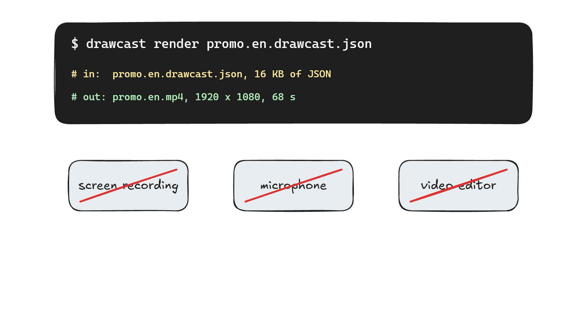

# Drawcast

Turn a JSON script into a narrated whiteboard video. Each step says something and draws something
on an [Excalidraw](https://excalidraw.com) canvas; Drawcast speaks the narration, draws each element
as its words are spoken, and writes an MP4.

```json
{
  "drawcast": 1,
  "steps": [
    {
      "say": "Take a client and a server. Every page load begins with a request from one to the other.",
      "do": [
        { "at": "client", "add": { "id": "client", "type": "rectangle", "x": 140, "y": 280, "width": 220, "height": 110, "label": "Client" } },
        { "at": "server", "add": { "id": "server", "type": "rectangle", "x": 900, "y": 280, "width": 220, "height": 110, "label": "Server" } },
        { "at": "request", "add": { "id": "request", "type": "arrow", "from": "client", "to": "server", "label": "GET /" } }
      ]
    }
  ]
}
```

```sh
npx drawcast render hello.drawcast.json     # writes hello.mp4
```

It is built for coding agents: a model writes faster than anyone reads, so let it draw and talk
instead.

[](promo/promo.en.drawcast.json)

That frame is from a 68 second video rendered from
[`promo/promo.en.drawcast.json`](promo/promo.en.drawcast.json). Shorter scripts are in
[`examples`](examples).

## Install

Your agent runs Drawcast, so ask your agent to install it. Paste this into Claude Code, Codex,
Cursor, Gemini CLI or any agent that can run shell commands:

```text
Install the Drawcast skill with `npx -y skills add gaojude/drawcast -g -y` and run `npx -y drawcast@latest setup`. Use the skill to make a short video explaining DNS with the built-in maple voice. Verify the MP4 and show it to me.
```

From then on, just ask for a video. The skill calls `npx -y drawcast@latest`, so nothing else needs
installing. Requires Node.js 22.12 or newer.

Other ways to give an agent the skill:

- `npx skills add gaojude/drawcast` installs it for this project only. Add `-g` for every project
  and `-a <agent>` to pick agents. [skills.sh](https://skills.sh) puts it where each agent looks.
- This repository is also a Claude Code plugin; its `skills` folder is picked up when installed as
  one.
- The skill is one Markdown file, [`skills/drawcast/SKILL.md`](skills/drawcast/SKILL.md), with
  nothing agent-specific in it. Any agent can also just run `npx -y drawcast@latest guide`.

### Without an agent

```sh
npm install -g drawcast
drawcast setup        # download everything now and report what is missing
```

Rendering needs three things. `drawcast setup` checks each one:

- **A speech model** (about 365 MB), downloaded once to a cache folder.
- **Chrome, Chromium or Edge**, to draw and encode frames. If none is installed, a headless Chrome
  is downloaded. A browser without an H.264 encoder works, several times slower.
- **ffmpeg**, from the `ffmpeg-static` dependency. If npm skips install scripts on your machine,
  install ffmpeg yourself or set `DRAWCAST_FFMPEG` to its path.

Downloads and the speech cache go in `%LOCALAPPDATA%\drawcast`, `~/Library/Caches/drawcast` or
`~/.cache/drawcast`. Set `DRAWCAST_HOME` to move them.

## Commands

```
drawcast guide [topic ...]     quick start, selected topics, or the full reference
drawcast check <script>        errors and layout warnings, without rendering
drawcast snapshot <script>     PNG stills: --sheet (all steps on one image), --step 2,5, --at 12.5
drawcast render <script>       the MP4 (-o out.mp4, --voice lin, --speed 1.1, --no-captions)
drawcast inspect <video.mp4>   sample frames from a rendered video
drawcast voices                list voices, and whether a MiniMax key is set up
drawcast key minimax           save your MiniMax API key (see MiniMax voices)
drawcast setup                 download what rendering needs and report what is installed
```

`drawcast guide` prints a short authoring workflow. `guide plots math` prints those topics;
`guide full` prints the [full reference](docs/format.md).

## Scripts

A script is a list of steps. Each step has narration (`say`) and actions (`do`). An action adds,
updates or removes an Excalidraw element, moves something along a path, sends a dot along an arrow,
pulses an element, moves the camera, or points at something. Its `at` is the phrase it starts on.
Sentence starts are timed exactly; a word inside a sentence lands within about a quarter second.

Beyond Excalidraw's shapes, text, arrows and images:

- `math` typesets LaTeX: `{ "type": "math", "tex": "\\frac{n(n+1)}{2}" }`. An update can replace
  it with the next line of a derivation. See
  [`examples/pythagoras.drawcast.json`](examples/pythagoras.drawcast.json).
- A `line` with `fn` plots a function, such as `"fn": "x^2 / 4"`, and things can roll along it.

The first frame is a cover showing the canvas after step 1, so video thumbnails are not blank.
`"cover": 3` picks another step; `"cover": false` removes it.

Whoever writes a script usually can't see it, so:

- `check` catches missing element references, `at` phrases the narration never says, overlapping
  shapes, arrows that cross or pass through things, labels that won't fit, and drawings hidden under
  captions.
- `snapshot --sheet` draws every step on one image in a second or two, with no speech.

## Voices

To generate speech in another tool, export a request with the script's sentences. After your
tool writes the WAV recording(s) and a result JSON, use the result with either command below.

```sh
drawcast narration export talk.drawcast.json -o request.json
drawcast render talk.drawcast.json --narration result.json -o talk.mp4
drawcast snapshot talk.drawcast.json --narration result.json --at 3
```

Drawcast can measure a WAV per sentence or read timestamped ranges from a longer take.
See the [request and result format](docs/format.md#external-recordings).

| Voice | Name in a script or `--voice` | Runs | Cost |
| --- | --- | --- | --- |
| Built-in Kokoro (default) | `maple`, `sol` (English), `lin`, `chen` (Mandarin) | your machine | free |
| MiniMax | `minimax:<voice id>`, e.g. `minimax:male-qn-qingse` | MiniMax's servers | paid, your account |
| Your own engine | `--tts-command "python my_tts.py"` | wherever your program sends it | — |

With no voice set, Drawcast uses `maple` for English narration and `lin` for Mandarin. Set a voice in
the script with `"voice": "sol"`, or override it at render time with `--voice sol`.

Drawing, encoding and default narration all run locally. Narration leaves your machine only if you
pick a `minimax:` voice or a `--tts-command` that sends it somewhere.

Scripts from before Edge TTS was removed may name an `edge:` voice. Those now fail to render; delete
the `voice` field or pick a built-in voice.

### Built-in voices

[Kokoro v1.1](https://huggingface.co/hexgrad/Kokoro-82M-v1.1-zh), run on the CPU by
[sherpa-onnx](https://github.com/k2-fsa/sherpa-onnx). It speaks Mandarin and English several times
faster than real time on a laptop. Apache-2.0.

The four named voices come from the model's 103 speakers. `maple` and `sol` are speakers as-is.
`chen` and `lin` each mix a Chinese speaker with a third of an English one, because the Chinese
speakers alone pronounce English terms poorly. Any speaker works by its model name, such as
`"voice": "zf_001"`.

### MiniMax voices

[MiniMax](https://platform.minimax.io)'s speech models are more expressive than the built-in voices.
They are paid: every character is billed to your MiniMax account. Drawcast only uses MiniMax when a
script or `--voice` names a `minimax:` voice. Having a key saved does not change the default.

To set it up:

1. **Get an API key** from MiniMax: [platform.minimax.io](https://platform.minimax.io) for the
   international platform, or [platform.minimaxi.com](https://platform.minimaxi.com) for mainland
   China.
2. **Give Drawcast the key, outside the agent chat.** Either:
   - Save it once in your own terminal. Paste the key at the prompt; it is not shown:

     ```sh
     npx -y drawcast@latest key minimax     # or `drawcast key minimax` if installed globally
     ```

     You can also pipe it in: `Get-Clipboard | npx -y drawcast@latest key minimax` or
     `pbpaste | npx -y drawcast@latest key minimax`. Agent sessions that are already open pick up the
     saved key with no restart.
   - Or set `MINIMAX_API_KEY` in your agent's environment or secret manager. It wins over a saved key.
3. **Check it:** `drawcast voices` (or `drawcast setup`) shows the last four characters of the key and
   where it came from.
4. **Ask for a MiniMax voice.** Tell your agent, for example, "use the MiniMax voice
   `minimax:male-qn-qingse`". The agent writes `"voice": "minimax:male-qn-qingse"` into the script,
   or you render with `--voice minimax:male-qn-qingse`.

Details:

- **Voice ids.** Any voice id from MiniMax's voice list works after `minimax:`, including voices you
  cloned. `drawcast voices` lists two Mandarin ones as examples; for English, pick an English voice id
  from MiniMax's list.
- **Model.** The default is `speech-2.8-hd`. Append `@speech-2.8-turbo` for the cheaper one:
  `minimax:male-qn-qingse@speech-2.8-turbo`.
- **Caching.** Each spoken sentence is cached. Re-rendering, or rendering after editing one sentence,
  pays only for new sentences.
- **Where a saved key lives.** A file named `minimax-api-key` in `%LOCALAPPDATA%\drawcast` on Windows,
  `~/Library/Application Support/drawcast` on macOS, or `~/.config/drawcast` on Linux
  (`DRAWCAST_HOME` moves it). On macOS and Linux it is readable only by you.
  `drawcast key minimax --remove` deletes it.
- **Platform.** Drawcast tries `api.minimax.io` first, then `api.minimaxi.com` if the key is
  rejected. Set `MINIMAX_API_HOST` to use one directly.
- **Never put the key in a script or the chat.** Scripts are shared and often written by an agent. If
  a render finds no key, it stops and says to run `drawcast key minimax`; the agent should ask you to
  do that rather than ask for the key.

### Your own engine

`--tts-command` runs a program once per sentence. It gets the sentence on stdin (and in
`$DRAWCAST_TEXT`) and must write a WAV file to the path in `$DRAWCAST_OUT`:

```sh
drawcast render talk.drawcast.json --tts-command "python my_tts.py"
```

## Token cost

A script says what to draw and leaves how to the renderer, so it is small.

| Script | Video | Script size | Final canvas as an Excalidraw scene |
| --- | --- | --- | --- |
| [`examples/cache.drawcast.json`](examples/cache.drawcast.json) | 16 s | 549 tokens | about 2,000 |
| [`examples/dns.drawcast.json`](examples/dns.drawcast.json) | 23 s | 716 tokens | about 2,550 |
| [`examples/binary-search.drawcast.json`](examples/binary-search.drawcast.json) | 25 s | 685 tokens | about 1,260 |
| [`promo/promo.en.drawcast.json`](promo/promo.en.drawcast.json) | 68 s | 5,995 tokens | about 16,800 |

The last column is only the final canvas, minified, with no narration or timing. It is still two to
four times the size of the script that draws, narrates and times it. The default guide is about 700
tokens; topics are read on demand.

Counts use `o200k_base`, OpenAI's offline tokenizer; other tokenizers differ somewhat. Scene sizes
vary by a fraction of a percent between runs because Excalidraw ids are random. To measure your own
script, clone the repository and run
`npm install && npm run build && node scripts/measure-tokens.mjs <script>`.

## Limits

- Chinese means Mandarin. The built-in voice supports no other languages.
- The built-in English dictionary has about 178,000 words. Unknown words are built from known ones or
  read by spelling rules, which sometimes gets names wrong. Respell a name the way it sounds if needed.
- English inside a Chinese sentence is less reliable than either language alone. In our tests a speech
  recogniser understood about four in five such words with `chen`, two in three with `lin`, and half
  with the model's raw Chinese speakers.
- A word's time inside its sentence is an estimate, good to about a quarter second. Sentence starts are
  exact.
- There is no audio besides the narration.

## Credits and licenses

Drawcast is MIT licensed. How it works inside, and how to build and test it, is in
[CONTRIBUTING.md](CONTRIBUTING.md). It builds on:

- [Excalidraw](https://github.com/excalidraw/excalidraw) (MIT), bundled into the player with its fonts.
- [MathJax](https://github.com/mathjax/MathJax-src) (Apache-2.0), bundled with its TeX font to
  typeset formulas.
- [sherpa-onnx](https://github.com/k2-fsa/sherpa-onnx) (Apache-2.0), which runs the speech model.
- [Kokoro v1.1](https://huggingface.co/hexgrad/Kokoro-82M-v1.1-zh) (Apache-2.0), the speech model,
  downloaded at run time in sherpa-onnx's packaging. Its pronunciation dictionaries come from
  [misaki](https://github.com/hexgrad/misaki) (Apache-2.0).
- ffmpeg, through [`ffmpeg-static`](https://github.com/eugeneware/ffmpeg-static), which downloads a
  GPL build and runs it as a separate program.

The timeline and drawing approach began in Boardcast, an app for trading whiteboard explanations with
an AI.
